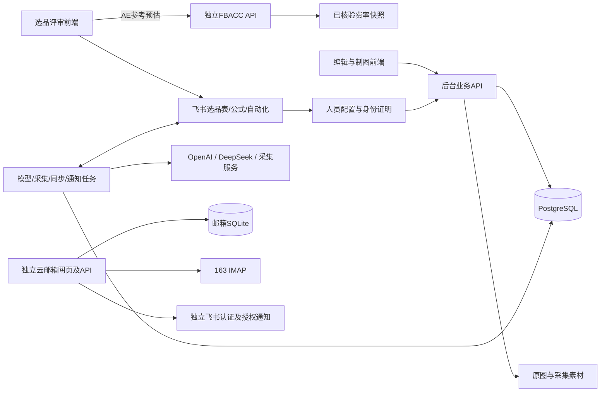

# 架构与独立系统迁移

## 为什么使用一个仓库

评审、内容编辑、制图交付共享商品、站点、运营归属、人员权限及状态定义。一次业务变化经常同时影响前后端和同步适配，因此共同评审、测试和追溯更合适。

| 模块 | 当前职责 | 当前数据依赖 | 版本方式 |
|---|---|---|---|
| review | 选品录入、测算、提审与主管审核 | 飞书表格、原生公式及自动化 | review/vX.Y.Z |
| editor | 产品资料、文案、图需、制图、验收及刊登界面 | 后台API | editor/vX.Y.Z |
| api | 业务规则、身份范围、版本、任务、图片及模型接入 | PostgreSQL、文件存储，飞书适配 | api/vX.Y.Z |
| fbacc | FBA 费用计算、计算器网页、HTTP接口与费率核验工具 | 已核验费率JSON，无飞书或数据库依赖 | fbacc/vX.Y.Z |
| mail | 聚合收件、邮件风险看板、邮箱授权与个人提醒 | 独立SQLite、163 IMAP、自己的飞书应用 | mail/vX.Y.Z |

合并仓库不等于合并为一个运行进程。API、采集、模型和通知可以分别扩容。无需为了开源立即引入微服务拆分或把所有模块强制升级成同一版本。

另预留`services/amazon-erp-material-service`作为ERP自动建料模块，**目前仅有规划文档，不属于已实现运行组件**。它拟从审核通过和共用产品资料准备建料草稿，经运营确认后创建/复用基础料及成品、读回核验并回填；建料流程与文案、制图、刊登独立。目录边界、数据契约和迁移方式见[ERP自动建料集成规划](erp-materials.md)。当前运行架构图不将该模块画作已接通服务。

FBACC 位于 `services/amazon-fbacc`，保留纯函数、网页和独立 HTTP 服务三种使用方式。当前评审适配器只将 AE 参考预估接入该 API；17站计算能力不等于评审台已接入全部17站。人工填写的费用和历史利润不由预估结果覆盖。日后评审服务化可以复用这个稳定接口，无需把计算逻辑并入业务数据库。费率监测只产生待审核资料，不能自动批准新费率。

云邮箱位于`services/store-mail-web`，前端静态资源和后端同包发布；没有新增`apps/mail`或重写为React。它使用自己的账号、整邮箱授权、SQLite、通知队列和加密主密钥，不继承编辑台会话或岗位权限。本次只集成代码与版本管理，统一入口、身份映射和数据库迁移均为后续事项，见[云邮箱集成边界](cloud-mail.md)。

## 当前已具备的迁移基础

- PostgreSQL内部UUID与飞书record_id分开，`external_bindings`、`external_identities`保存外部映射。
- 商品编辑稿、确认版本、制图批次、交付版本、逐图意见、文案刊登和图片刊登分别持久化。
- 图片归属、存储键、文件哈希与交付版本保存在数据库，原图保存在独立存储；飞书附件是投影副本。
- 任务队列、事务outbox、审计记录不依赖飞书视图。
- `python -m amazon_aigc.cli export --output NEW_DIRECTORY`可导出领域表及素材并校验哈希。正式全量迁移还应包含完整数据库备份、密钥文件及所有任务/配置表；领域导出不能替代灾备。

## 尚需迁移的部分

- 评审台直接读写飞书，审核状态流转、公式、通知依赖原生自动化。需要把这些逻辑移到自建API，不能直接删表。
- 当前人员配置和身份证明仍通过飞书；独立系统需要统一登录、岗位/小组管理及服务端权限来源，不能信任浏览器传来的角色。
- 原生插件使用特定字段名称与类型，不包含可直接复用的企业权限配置或业务记录。开源接入需要建立自己的schema与流程。

## 推荐迁移顺序

1. **统一代码与接口契约**：在本仓库开发，环境配置放私有配置；保持两个前端和后台的版本兼容记录。
2. **评审服务化**：为选品草稿、提交、审核和财务快照增加独立API与领域表；将现有表格repository替换为API repository。比对历史样本，避免重算已有利润。
3. **统一人员与工作台入口**：保留飞书SSO作为登录选项，岗位权限由后端管理；原生插件与独立网页共用同一业务API。
4. **数据迁移和逐组切换**：导入选品、审核历史、图片和在途任务；记录数量、状态、所属人及文件哈希对账。单一写入权威，避免两个系统同时更新同一状态。
5. **逐步停用飞书业务存储**：先关闭旧表写入，保留只读追溯；再停用双写和旧自动化。飞书仍可作为消息与组织接入。

这一路线支持未来一体化系统；本次开源整理没有执行生产数据迁移，也不代表评审服务化已经完成。
