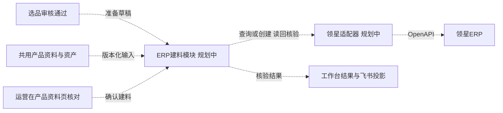

# ERP 自动建料集成规划

规划版：v0.1，2026-11-10。**仅规划，未实现、未接入、未部署。**

业务基线：自动准备建料资料、运营核对、一键创建领星产品、读回核验、回填结果。本文件将该流程纳入单仓库架构，定义模块边界、版本保护和失败恢复设计；文档能力核验不等同于企业账号已具备写入权限。

## 1. 业务目标与首期范围

复用工作台已有的选品SKU、品名、1688链接、所选规格、组成用量、图片和运营归属，减少重复录入。选品通过后准备草稿；只有运营确认建料，才允许未来执行ERP写入。无需等待Listing文案、图需、成品图或刊登完成。

首期规划覆盖普通单品、同款多规格、组合套装。普通单品按一个明确库存单位建档；多规格分别核对每个SKU和图片，不把规格列表自动当作组合BOM；组合先复用或创建基础料，再建立成品和组成关系。是否建立SPU及使用何种接口需在实施前验证。

不新增建料审批层。采购员、交期可在实际采购时补充；包装尺寸和重量标明资料来源，未知保留待实测，不填0凑数。该模块不创建采购单、1688订单、加工单或库存变动，不承担自动刊登。

## 2. 与现有模块的衔接

图中虚线均为未来接入，不代表已经实现。模块定位为`services/amazon-erp-material-service`；前端未来在现有编辑台内提供入口，不新建独立前端应用。领域逻辑不依赖飞书Base/记录ID，也不依赖某一LLM。

| 现有来源 | 未来复用方式 | 必须区分 |
|---|---|---|
| `work_items`、`review_snapshots` | 商品内部ID、SKU、品名、审核状态及来源版本 | 已通过审核不是已完成ERP建料 |
| `content_documents`、`content_versions` | 读取共用产品资料及修订号，不复制成新的长期商品主档 | ERP确认快照不是产品资料确认；不代改资料确认状态 |
| `facts.components` | 组成ID、规格、用量、单位、货源引用、供应商规格ID | 编辑用量可能是小数，不能直接当作ERP组合数量 |
| 来源快照、规格选择 | 对应规格图片、报价、链接、采集时间 | 报价不是最终采购成本，也不是1688正式配对 |
| `assets` | 按权限取得图片引用与文件哈希 | 不直接把需登录的工作台图片URL发给第三方 |
| 身份、岗位和小组范围 | 复用服务端鉴权，另明确谁可确认建料 | 能查看商品不等于有ERP写权限 |
| 现有ERP字段 | 成功后按环境字段映射回填 | 领星已核验与飞书回填成功是两个结果 |

选品信息或产品资料未完整时允许形成待补充草稿；确认建料需补齐该操作所需关键字段。此确认不要求文案或图需完成，也不伪造产品资料“已确认”。资料确认、建料确认、文案确认分别保留各自事实。

## 3. 运营交互与执行流程

1. **准备草稿**：消费审核通过的版本化事件；重审或重复事件只定位现有草稿，不重复建档。已有ERP记录先核验关联，不直接新建。
2. **查重与映射**：按明确SKU/既有映射查询，展示成品和基础料的复用候选。仅名称相似不得自动合并；规格、单位和包装口径均须一致。分类和负责人按配置映射，缺失或多义时由运营选择一次，保存映射需具备相应权限。
3. **核对与确认**：页面集中展示新建/复用清单、库存单位、最终采用成本、组合用量、所选图片、未解决事项。点击“确认建料”锁定本次输入快照和请求ID，不另增加主管审批。
4. **后台执行**：复查当前权限、审核状态及资料版本；先处理基础料，再处理成品/组成；处理图片并读回。页面显示阶段与具体失败项，可离开后继续查看。
5. **回填结果**：全套要求核验成功后记录ERP产品ID、具体SKU、核验时间，再更新飞书投影。多个SKU必须逐个核验，不能只回填SPU或首个成功SKU。

预计入口为产品资料页的“领星建料”。侧面抽屉或大弹层展示草稿、执行进度和结果；具体界面待后续原型确认。本轮不增加按钮或页面。重试只恢复失败/未完成步骤，已存在产品默认复用，不自动覆盖ERP人员维护的成本、图片或其他字段。

## 4. 单位、数量与成本

每个基础料都必须明确：1688下单1份的实际内容、ERP库存1单位的实际内容、每份成品消耗多少库存单位。MOQ/起批量、供应商固定包装数量、成品装数分别记录，不能由AI或SKU后缀猜出单位含义。

同一物理计量口径下，设供应商1份包含`s`件，ERP1单位包含`u`件，成品包含该基础物料`g`件，则：

- 组合用量为`g/u`个ERP库存单位。
- 1688配对比为`u/s`，对应未来采购下单数量换算。
- 报价为每份`p`元时，单个ERP库存单位的材料成本建议为`p×u/s`；须保留报价条件和计算来源，由运营确定最终成本。

上述仅用于口径已经确认的固定包装。组合用量若非合法整数，需调整库存单位或转人工处理，不自动四舍五入。现有编辑资料允许小数用量，而官方创建接口的组合数量为整数，实施时必须显式校验这一差异。[领星产品接口](https://apidoc.lingxing.com/new/api-docs/Product/SetProduct/)

| 1688一份2支、成品10支装 | ERP基础料单位 | 成品用量 | 配对比 |
|---|---|---|---|
| 整包收货、整包领用 | 包，1包2支 | 5包 | 1 |
| 单支库存、可管理余料 | 支，1支 | 10支 | 0.5 |

配对比用于换算订单数量，不能证明供应商已完成组套。由供应商成套交付与由仓库组套必须由运营选择；多货源组合中的每个基础商品分别保留自己的货源与规格。官方配对数量关系及批量配对限制见[1688商品配对说明](https://www.lingxing.com/help/article/1688Product)。

采购成本建议、供应商报价、实际采购订单价格分别保存语义。组合成本按已确认基础料单位计算，包材/加工费按明确口径另列，避免重复计入；含税、运费、币种及价格阶梯不明确时不强行换算。最终成本仍由运营核对，不覆盖既有选品成本、历史利润或复用料号的成本。

## 5. 独立模块框架与契约草案

本节是设计约定，不是已存在的HTTP端点或代码接口。

| 边界契约 | 输入 | 输出/约束 |
|---|---|---|
| 商品资料读取 | 内部商品ID、资料修订号、可信服务端身份 | 有权限的审核/资料/图片快照；可替换Feishu来源 |
| 草稿准备 | 审核事件ID、快照版本 | 可重复定位的草稿、缺项、来源；不写ERP |
| 物料查询 | ERP连接标识、SKU或已确认物料标识 | 精确命中、候选、多义/冲突；相似名称不自动复用 |
| 建料确认 | 草稿版本、逐项复用/新建决策、单位/成本/图片核对、幂等键 | 已确认快照和执行任务；服务器重新校验权限及版本 |
| ERP执行适配 | 已确认的具体步骤、外部SKU、期望字段摘要 | 创建/复用标识、供应商请求ID、结果；不泄露凭证 |
| 读回核验 | 外部产品ID/SKU、期望快照摘要 | 字段/图片/组成对账，缺项明细及核验时间 |
| 结果投影 | 全部物料结果、关联商品ID、来源版本 | 工作台结果、飞书回填状态；可独立重试 |
| 恢复执行 | 原请求ID、失败步骤、核验结果 | 只处理仍未完成步骤；未知结果先查证 |

领域层只认识内部ID、物料、单位和状态；领星字段、签名与令牌属于适配层。服务器管理连接和ERP写权限；前端不持有长期凭证，也不能用传入的操作者姓名代替授权。图片通过授权资产服务生成受控、足够有效期的下载地址，需核验第三方可获取后才能标记完成。[图片接口要求](https://apidoc.lingxing.com/new/api-docs/Product/UploadPictures/)

## 6. 数据归属与持久化草案

只规划以下三类记录，不创建SQL，也不把大对象塞回SKU登记表：

| 逻辑记录 | 关键内容 |
|---|---|
| 建料请求 | 商品内部ID、环境/ERP连接、草稿修订号、确认快照、操作者、整体状态和时间 |
| 物料映射 | 内部物料标识、ERP产品ID及SKU、单位口径、明确复用决策、最近核验摘要；允许多商品复用同一基础料 |
| 执行步骤 | 请求ID、物料与动作、幂等键、状态、尝试次数、外部请求ID、核验结果和错误 |

分类/人员映射按ERP连接隔离，可先复用配置机制，不为首期预建大量配置表。队列、审计和回填outbox优先复用已有机制，但不得直接把ERP任务塞入尚未支持的现有枚举。本仓库现有`external_bindings`是商品到飞书记录的映射，不能直接当作多基础料的ERP关系表。

回填优先复用`领星SKU`、`ERP录入状态`等现有字段；详细步骤留在服务端。具体字段类型、工作流触发及读写归属要在实施前审计，避免审核自动化和新模块同时维护同一个状态。ERP完成但飞书失败时显示“建料已完成，结果待同步”，仅补回填，不重建产品。

未来脱离飞书后，用内部商品与人员API替换输入、投影适配器即可，物料映射和执行历史继续保留。导出应包含请求快照、映射、步骤和审计记录；凭证仍由私有运维机制备份，不进入公开仓库。

## 7. 状态、并发与异常处理

运营可见状态尽量控制为“待核对、建料中、需处理、已完成”。详细执行阶段在任务详情呈现；产品资料、文案、图需、刊登状态互不代替。

- “需处理”说明具体缺项、冲突或失败步骤；已完成部分继续保留，不假装整批成功。
- 只在产品、单位、必要成本、组成及图片读回符合确认快照后，标记建料完成。图片失败可以保留已建物料，但不能当作全流程完成。
- 写入请求超时/断连属于“结果待核实”：先按SKU和请求证据查询，再决定是否重试。添加/编辑共用接口的重发可能修改既有产品，不能把它当作天然幂等的新增接口。
- 以ERP连接＋规范化SKU/物料标识控制本模块并发，多个商品共用基础料时串行确认创建。该锁不能约束人工或其他系统同时写ERP；发现外部变动/重码需停止并对账，不能无条件覆盖。
- 资料更新使未执行的确认快照过期时，重新核对后再执行；运行中的请求使用原快照，后续变化作为新请求，不拼接新旧资料。已建成功的外部料号不自动删除回滚。
- 限流、重试间隔、超时和最大次数按供应商实测能力配置；ERP队列与AI生成/采集任务分开限流。自动重试仅适用于可证实安全的步骤，不能无限重试。
- 草稿刷新与执行进度查询不得覆盖未保存的编辑内容、返修意见或图片上传。既有10秒列表刷新规则保持独立。

## 8. 1688配对与待核验能力

ERP产品建档、采购链接保存、1688规格配对分别记录。第一阶段规划采用领星原生批量配对或其官方模板；本模块保留规格、货源和配对比，提供操作交接资料。不能用解析成功或产品创建成功推定正式配对完成。

公开配对写入接口尚未完成核验，企业账号产品写入授权也未核验；已有MCP查询能力不作为写入链路依据。能力清单和官方资料见[领星接入规划](../integrations/lingxing/README.md)。上述事项决定后续实施方式。

## 9. 后续实施顺序与验收清单

以下均为未来待办，本轮不执行：

- [ ] 核验企业API读写授权、账号范围、产品查询/分类/人员能力、接口限流及错误处理；确定ERP状态的唯一回填方。
- [ ] 确认分类/人员映射、基础料编码、库存单位、成本口径、复用证据和图片可达方式；补齐隔离测试环境。
- [ ] 先实现草稿与只读查重，再实现经确认的创建、读回及结果回填；完成原型和契约评审后启用写入。
- [ ] 普通单品、同款多规格、同货源及多货源组合分别验证；核对图片与规格对应关系。
- [ ] 验证2支包/单支库存/10支成品两种单位路径，拒绝把MOQ当包装件数及非法小数组成用量。
- [ ] 验证精确复用、名称相似但规格不同、两个运营并发创建共用基础料、重审重复事件和重复点击。
- [ ] 验证创建超时后已成功、部分基础料失败、图片失败、成品失败、读回不一致、飞书回填失败及恢复执行。
- [ ] 验证运行中资料修改、人员停用/越权、外部人工修改冲突、旧ERP记录核验接管和未保存内容保护。
- [ ] 用获准业务完成运营真人验收后再逐步上线；不把合成测试或文档审查当作已上线。

## 10. 本次规划变更的验收

本次只新增本规划、模块README和领星接入能力说明，并在根README/架构/版本说明中建立入口。不增加源码、API路由、迁移、测试用业务记录、配置凭证或运行任务，不发布ERP模块版本，不改变当前部署。实施需另行授权。
